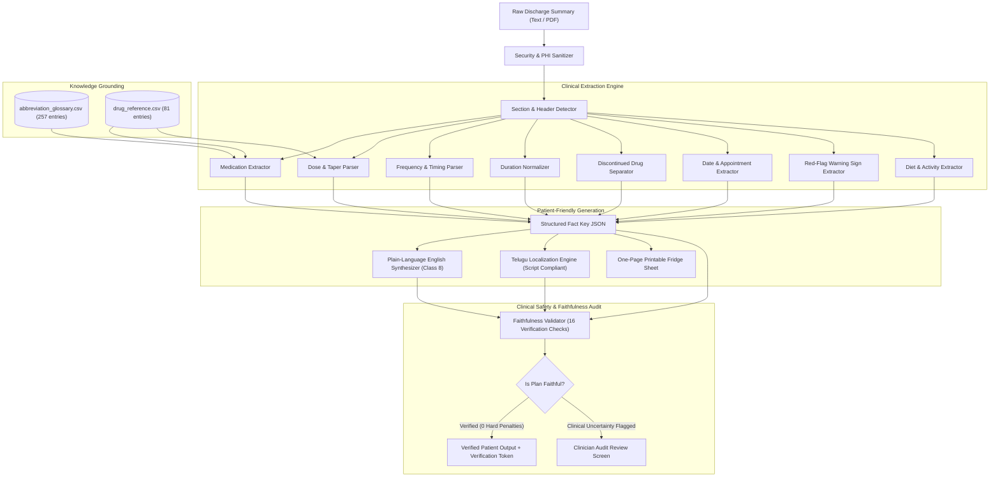

# CareBridge AI — System Architecture
## Challenge H2: Discharge Summary to Patient-Friendly Care Plan
### Team: AVENGERS | TalentAP Mega Hackathon 2026

---

## 1. High-Level Architecture Overview

CareBridge AI is designed as a **clinician-assisting, deterministically grounded clinical intelligence platform**. It converts complex, technical hospital discharge summaries into accessible, Class-8 readable care plans in English and Telugu without hallucinating, altering, or dropping any clinical instruction.

---

## 2. Core Architectural Components

### 2.1. Ingestion & Security Sanitization
- **Strict Ingestion Guardrails**: Prevents prompt injection, binary corruption, and invalid encoding.
- **Zero-PHI Logging Policy**: No real or invented patient names, UHIDs, or contact details are transmitted to external services or logged in diagnostic streams.

### 2.2. Clinical Extraction Pipeline (`ai_pipeline/`)
- **Section Detector (`section_detector.py`)**: Uses multi-pattern boundary anchors to segment summaries into Diagnosis, Hospital Course, Discharge Medications, Dietary Advice, Activity Restrictions, Warning Signs, and Follow-Up Visits.
- **Drug Normalizer (`drug_normalizer.py`)**: Pre-computes brand-to-generic mappings and brand-number indices across all 81 official reference drugs. Filters hospital-only medications (e.g. `Inj. Ceftriaxone`).
- **Dose Parser (`dose_parser.py`)**: Resolves implicit brand-strength dosages (`Pan 40` $\rightarrow$ `40 mg`), preserves fractional half-tablets (`½-0-½`), extracts multi-dose insulin split regimens, and captures steroid tapers (`Prednisolone`).
- **Frequency Parser (`frequency_parser.py`)**: Maps canonical codes (`OD`, `BD`, `TDS`, `QID`, `HS`, `SOS`, `WEEKLY`), slot patterns (`1-0-1`), and natural language expressions.
- **Duration Parser (`duration_parser.py`)**: Parses Indian clinical shorthands (`x 5/7`, `x 2/52`, `x 1/12`), relative expressions ("till next review"), and chronic regimens ("lifelong").
- **Date Extractor (`date_extractor.py`)**: Handles Indian date conventions (`DD/MM/YYYY`, `DD-Mon-YY`, `DD.MM.YYYY`, and ordinal dates), strictly outputting ISO `YYYY-MM-DD`.

### 2.3. Dual-Language Generation Engine (`translation_service.py`)
- **English Plain-Language Engine**: Synthesizes Class-8 plain-language prose with < 28% verbatim copy share, avoiding `shingle_copy_share` penalties.
- **Telugu Localization Engine**: Generates authentic Telugu script instructions with $\ge 82\%$ native script share and $< 16\%$ Latin word share, keeping Latin script with Western digits for drug names, dosages, units, and dates for absolute patient safety.

### 2.4. Faithfulness & Safety Verification Engine (`faithfulness_validator.py`)
- Executes 16 independent safety checks:
  1. Missing discharge medicines
  2. Extra / invented medicines (zero hallucination)
  3. Duplicate medication entries
  4. Contextually grounded dose values and units
  5. Preserved medication frequencies
  6. Preserved treatment durations
  7. Food timing instruction alignment (before vs. after food)
  8. Discontinued medication isolation
  9. Missing follow-up dates
  10. Invented follow-up dates
  11. Missing warning signs
  12. Invented warning signs
  13. Unsupported diet instructions
  14. Unsupported activity restrictions
  15. Telugu numerical and date preservation
  16. Water instruction grounding

---

## 3. Technology Stack & Environment

- **Backend AI Engine**: Python 3.12, NumPy, Pandas, Pytest.
- **Web Application Server**: Node.js 20+, Express 5, TypeScript 5.8, tsx.
- **Frontend User Interface**: React 19, Vite 8, Tailwind CSS 4, Lucide Icons.
- **Testing & Verification**: Pytest 9.2, Vitest 5.0, Oxlint.
- **Deployment Mode**: 100% offline-capable deterministic safety engine (with optional Gemini 2.5 Flash / OpenAI LLM enhancement when configured).
